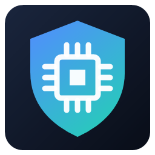
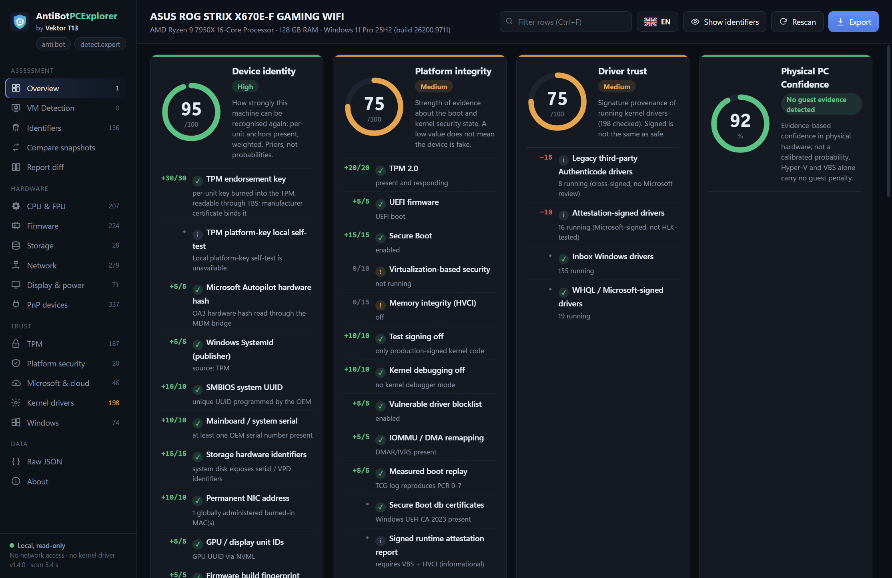
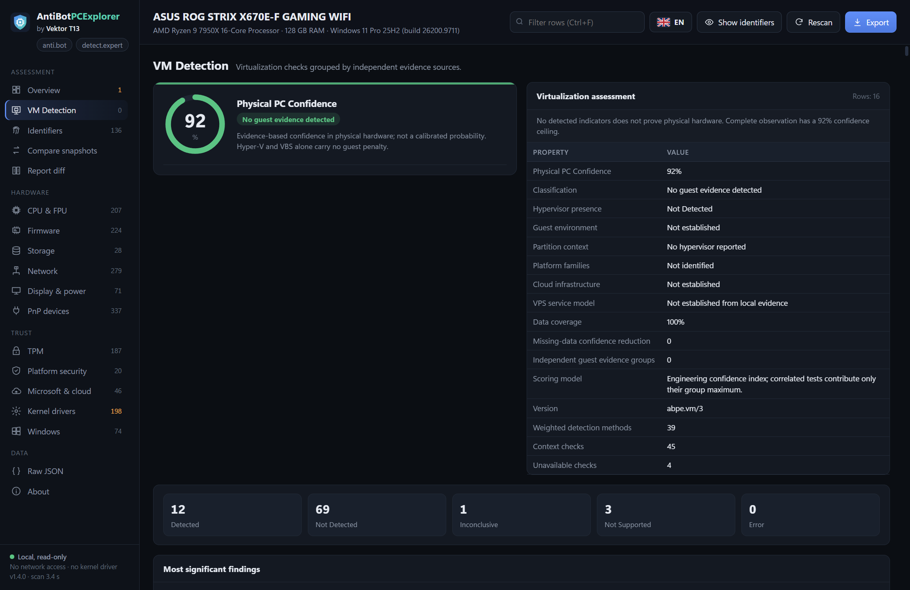
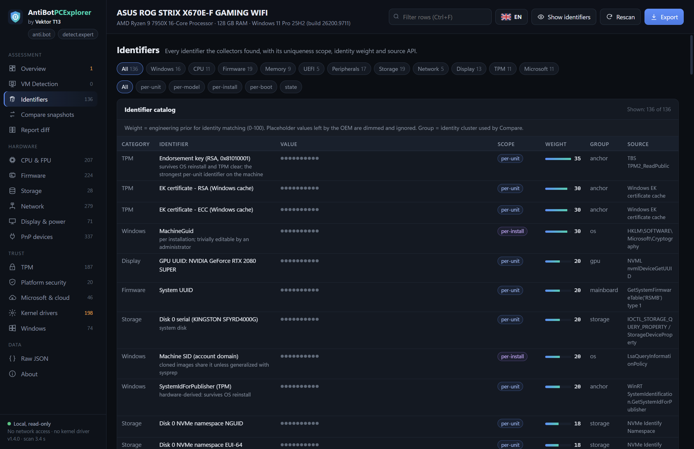

<p align="center">
  <a href="README.md">🇬🇧 English</a> · <a href="README.ru.md">🇷🇺 Русский</a> · <a href="README.vi.md">🇻🇳 Tiếng Việt</a> · <a href="README.zh-Hant.md">🇹🇼 繁體中文</a>
</p>

<p align="center">
  
</p>
<h1 align="center">AntiBotPCExplorer - VM Detection and Hardware Fingerprinting</h1>
<p align="center"><strong>Know your hardware. Understand your device identity.</strong><br>Device fingerprints, platform security and virtualization diagnostics for Windows.<br>by <strong>Vektor T13</strong></p>
<p align="center"><a href="https://detect.expert">detect.expert</a> · <a href="https://anti.bot">anti.bot</a> · <a href="https://antidetect.com">antidetect.com</a></p>

<p align="center">
  <a href="https://github.com/vektort13/AntiBotPCExplorer-VM-Detection-and-Hardware-Fingerprinting/releases/latest"></a>
  <a href="https://github.com/vektort13/AntiBotPCExplorer-VM-Detection-and-Hardware-Fingerprinting/releases"></a>
  
  <a href="LICENSE"></a>
  
</p>

<p align="center">
  <a href="https://github.com/vektort13/AntiBotPCExplorer-VM-Detection-and-Hardware-Fingerprinting/releases/latest/download/AntiBotPCExplorer-1.4.0-x64.exe"></a>
</p>
<p align="center">
  <a href="https://github.com/vektort13/AntiBotPCExplorer-VM-Detection-and-Hardware-Fingerprinting/releases/latest">Latest release</a> · <a href="docs/installation.md">Installation</a> · <a href="docs/features.md">Features</a> · <a href="docs/faq.md">FAQ</a> · <a href="https://github.com/vektort13/AntiBotPCExplorer-VM-Detection-and-Hardware-Fingerprinting/issues">Support</a>
</p>

---

AntiBotPCExplorer brings hardware identifiers, firmware information, TPM evidence, Windows identity and platform security into one desktop inspector. Explore the signals that identify a computer, examine virtualization evidence and compare reports before and after a system change.

**One portable executable. Local diagnostics. Identifiers hidden by default.** The application is digitally signed by **Vektor T13 Technologies B.V.**

<p align="center">
  
</p>

## What you can do

| Capability | What you get |
|---|---|
|  **Explore device identity** | CPU and FPU profiles, firmware, storage, network adapters, displays, PnP devices and Windows identifiers in one place. |
|  **Inspect platform trust** | TPM properties, Secure Boot, VBS/HVCI, boot evidence and kernel driver signature information. |
|  **Compare system snapshots** | Identity cluster comparison, what-if scenarios and field-by-field report differences with volatile fields filtered out. |
|  **Keep diagnostics local** | Offline collection, masked identifiers and privacy-safe JSON exports with HMAC tags. |

### Virtualization at a glance

Version **1.4.0** adds a dedicated **VM Detection** page and a **Physical PC Confidence** score. Inspect grouped evidence, check statuses, score contributions and technical details across CPU, firmware, devices, graphics and guest integration components.

The assessment accounts for correlated evidence and unavailable data. Hyper-V or VBS running on a physical Windows host is handled separately from evidence of a guest VM.

<details>
<summary><strong>View VM Detection and the identifier catalog</strong></summary>

### VM Detection



### Identifiers



</details>

## Start in a minute

1. [Download AntiBotPCExplorer 1.4.0 for Windows x64](https://github.com/vektort13/AntiBotPCExplorer-VM-Detection-and-Hardware-Fingerprinting/releases/latest/download/AntiBotPCExplorer-1.4.0-x64.exe).
2. Save the `.exe` in a folder of your choice and double-click it. No installer is needed.
3. If the window reports a missing runtime, install the [Microsoft Edge WebView2 Runtime](https://developer.microsoft.com/en-us/microsoft-edge/webview2/) and launch the application again.
4. Explore **Overview**, open a detailed page or export a report. Select your interface language from the flag menu.

Use a standard Windows account for everyday inspection. **Run as administrator** makes additional protected firmware and system information available.

| Requirement | Supported configuration |
|---|---|
| Operating system | Windows 10 or Windows 11 |
| Architecture | x64 (64-bit Intel / AMD) |
| Desktop interface | Microsoft Edge WebView2 Runtime |
| Installation | Portable `.exe`; no .NET installation required |
| Internet connection | Not needed for diagnostics |

See the [installation guide](docs/installation.md) for runtime setup, SHA-256 verification, updates and command-line usage.

## Reports that work with your workflow

Export a privacy-safe JSON report without opening the desktop interface:

```powershell
Start-Process .\AntiBotPCExplorer-1.4.0-x64.exe -ArgumentList '--export','report.json' -Wait
```

Open the interface in a specific language:

```powershell
.\AntiBotPCExplorer-1.4.0-x64.exe --lang en
```

The desktop interface includes **Compare snapshots** and **Report diff**. Reports created with the same local HMAC key can be compared while their identifiers remain masked. [Learn about reports and local data](docs/privacy.md).

## Built with

<p>
  
  
  
  
  
  
</p>

A native C++ application using Windows APIs and an embedded HTML, CSS and JavaScript interface rendered with Microsoft Edge WebView2. The interface and translations are included in the executable.

## Languages

**Application interface — 9 languages:** English, Русский, Tiếng Việt, 简体中文, 繁體中文, Español, Português (Brasil), Français and Deutsch.

**Product documentation — 4 languages:** [English](README.md), [Русский](README.ru.md), [Tiếng Việt](README.vi.md) and [繁體中文](README.zh-Hant.md). Each edition includes installation, features, FAQ and privacy documentation.

## Documentation and support

| Resource | Link |
|---|---|
| Install, run, update and verify downloads | [Installation](docs/installation.md) |
| Explore the inspector and report tools | [Feature guide](docs/features.md) |
| Common questions | [FAQ](docs/faq.md) |
| Exports, identifier masking and local data | [Privacy and reports](docs/privacy.md) |
| Version history | [Changelog](CHANGELOG.md) |
| Downloads and release notes | [GitHub Releases](https://github.com/vektort13/AntiBotPCExplorer-VM-Detection-and-Hardware-Fingerprinting/releases) |
| Bugs, questions and feature requests | [GitHub Issues](https://github.com/vektort13/AntiBotPCExplorer-VM-Detection-and-Hardware-Fingerprinting/issues) · [Feedback guide](CONTRIBUTING.md) |
| Security reports | [Security policy](SECURITY.md) |
| Product websites | [detect.expert](https://detect.expert) · [anti.bot](https://anti.bot) · [antidetect.com](https://antidetect.com) |

## Distribution

AntiBotPCExplorer is a **proprietary, closed-source product**. This repository hosts official documentation, product images and binary releases. The application source code is kept private. See [LICENSE](LICENSE) and [third-party notices](THIRD_PARTY_NOTICES.md).
