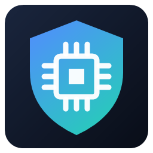
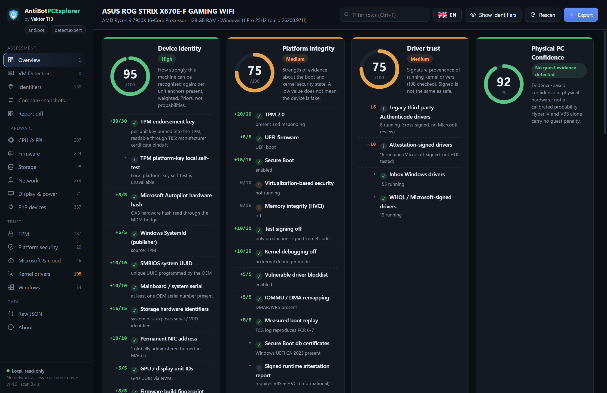
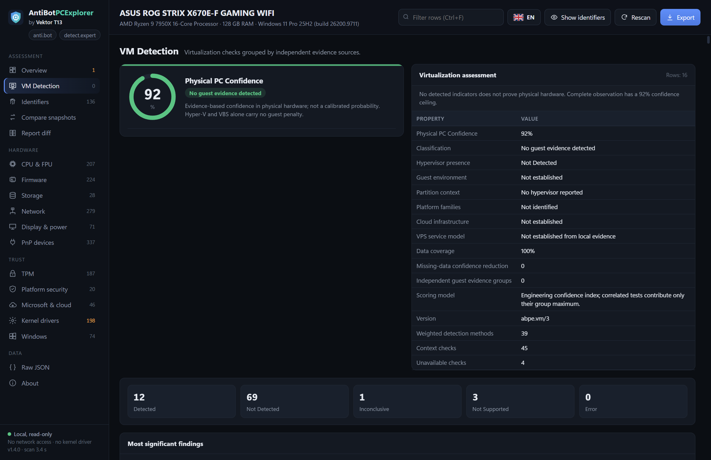
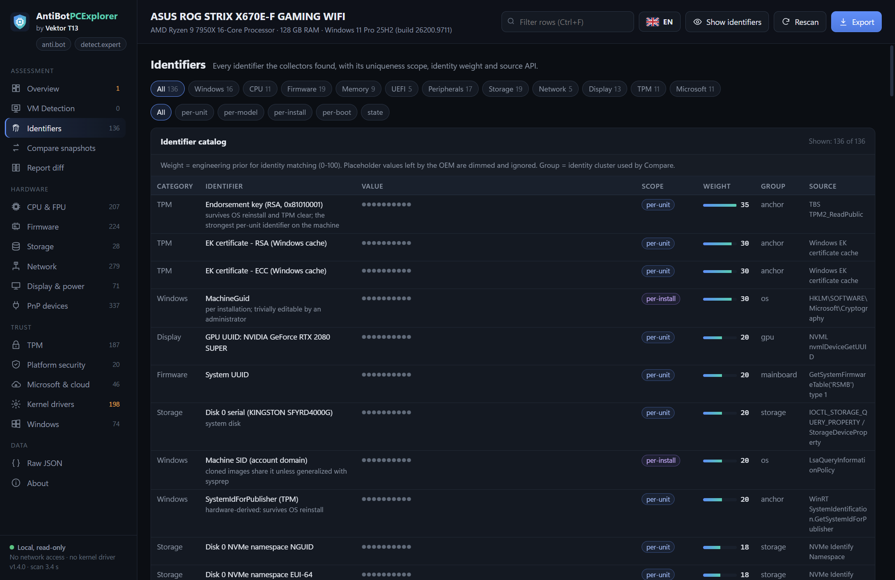

<p align="center">
  <a href="README.md">🇬🇧 English</a> · <a href="README.ru.md">🇷🇺 Русский</a> · <a href="README.vi.md">🇻🇳 Tiếng Việt</a> · <a href="README.zh-Hant.md">🇹🇼 繁體中文</a>
</p>

<p align="center">
  
</p>
<h1 align="center">AntiBotPCExplorer - VM Detection and Hardware Fingerprinting</h1>
<p align="center"><strong>Узнайте своё оборудование. Разберитесь в идентичности своего устройства.</strong><br>Аппаратные отпечатки, безопасность платформы и диагностика виртуализации в Windows.<br>от <strong>Vektor T13</strong></p>
<p align="center"><a href="https://detect.expert">detect.expert</a> · <a href="https://anti.bot">anti.bot</a> · <a href="https://antidetect.com">antidetect.com</a></p>

<p align="center">
  <a href="https://github.com/vektort13/AntiBotPCExplorer-VM-Detection-and-Hardware-Fingerprinting/releases/latest"></a>
  <a href="https://github.com/vektort13/AntiBotPCExplorer-VM-Detection-and-Hardware-Fingerprinting/releases"></a>
  
  <a href="LICENSE"></a>
  
</p>

<p align="center">
  <a href="https://github.com/vektort13/AntiBotPCExplorer-VM-Detection-and-Hardware-Fingerprinting/releases/latest/download/AntiBotPCExplorer-1.4.0-x64.exe"></a>
</p>
<p align="center">
  <a href="https://github.com/vektort13/AntiBotPCExplorer-VM-Detection-and-Hardware-Fingerprinting/releases/latest">Последний релиз</a> · <a href="docs/ru/installation.md">Установка</a> · <a href="docs/ru/features.md">Возможности</a> · <a href="docs/ru/faq.md">Вопросы и ответы</a> · <a href="https://github.com/vektort13/AntiBotPCExplorer-VM-Detection-and-Hardware-Fingerprinting/issues">Поддержка</a>
</p>

---

AntiBotPCExplorer объединяет аппаратные идентификаторы, сведения о прошивке, данные TPM, идентификаторы Windows и состояние безопасности платформы в одном настольном инспекторе. Изучайте признаки, по которым можно узнать компьютер, анализируйте свидетельства виртуализации и сравнивайте отчёты до и после изменений в системе.

**Один портативный исполняемый файл. Локальная диагностика. Идентификаторы скрыты по умолчанию.** Приложение подписано цифровой подписью **Vektor T13 Technologies B.V.**

<p align="center">
  
</p>

## Что умеет программа

| Возможность | Результат |
|---|---|
|  **Изучение идентичности устройства** | Профили CPU и FPU, прошивка, накопители, сетевые адаптеры, дисплеи, PnP-устройства и идентификаторы Windows в одном месте. |
|  **Проверка доверия к платформе** | Свойства TPM, Secure Boot, VBS/HVCI, данные о загрузке и сведения о подписях драйверов ядра. |
|  **Сравнение снимков системы** | Сопоставление кластеров идентичности, сценарии «что если» и сравнение отчётов по полям с фильтрацией изменчивых значений. |
|  **Локальная диагностика** | Сбор данных без сети, скрытые идентификаторы и JSON-отчёты с HMAC-тегами вместо чувствительных значений. |

### Виртуализация — на одном экране

В версии **1.4.0** появились отдельная страница **VM Detection** и оценка **Physical PC Confidence**. Изучайте сгруппированные свидетельства, статусы проверок, их вклад в оценку и технические подробности по CPU, прошивке, устройствам, графике и компонентам интеграции гостевых систем.

При оценке учитываются взаимосвязанные свидетельства и недоступные данные. Hyper-V или VBS на физическом компьютере с Windows рассматриваются отдельно от признаков гостевой ВМ.

<details>
<summary><strong>Посмотреть VM Detection и каталог идентификаторов</strong></summary>

### VM Detection



### Идентификаторы



</details>

## Начните за минуту

1. [Скачайте AntiBotPCExplorer 1.4.0 для Windows x64](https://github.com/vektort13/AntiBotPCExplorer-VM-Detection-and-Hardware-Fingerprinting/releases/latest/download/AntiBotPCExplorer-1.4.0-x64.exe).
2. Сохраните `.exe` в удобную папку и дважды щёлкните по нему. Установщик не нужен.
3. Если программа сообщает об отсутствии среды выполнения, установите [Microsoft Edge WebView2 Runtime](https://developer.microsoft.com/en-us/microsoft-edge/webview2/) и запустите приложение снова.
4. Изучите **Overview**, откройте подробный раздел или экспортируйте отчёт. Язык интерфейса выбирается в меню с флагом.

Для повседневной диагностики достаточно обычной учётной записи Windows. **Запуск от имени администратора** открывает доступ к дополнительным защищённым сведениям о прошивке и системе.

| Требование | Поддерживаемая конфигурация |
|---|---|
| Операционная система | Windows 10 или Windows 11 |
| Архитектура | x64 (64-разрядные Intel / AMD) |
| Графический интерфейс | Microsoft Edge WebView2 Runtime |
| Установка | Портативный `.exe`; установка .NET не требуется |
| Подключение к интернету | Для диагностики не требуется |

В [руководстве по установке](docs/ru/installation.md) описаны настройка среды выполнения, проверка SHA-256, обновление и работа из командной строки.

## Отчёты для вашего рабочего процесса

Экспортируйте JSON-отчёт со скрытыми чувствительными значениями без открытия графического интерфейса:

```powershell
Start-Process .\AntiBotPCExplorer-1.4.0-x64.exe -ArgumentList '--export','report.json' -Wait
```

Откройте интерфейс на выбранном языке:

```powershell
.\AntiBotPCExplorer-1.4.0-x64.exe --lang en
```

В приложении есть **Compare snapshots** и **Report diff**. Отчёты, созданные с одним локальным ключом HMAC, можно сравнивать, оставляя идентификаторы скрытыми. [Подробнее об отчётах и локальных данных](docs/ru/privacy.md).

## Технологии

<p>
  
  
  
  
  
  
</p>

Нативное приложение на C++, использующее Windows API и встроенный интерфейс на HTML, CSS и JavaScript, который отображается через Microsoft Edge WebView2. Интерфейс и переводы включены в исполняемый файл.

## Языки

**Интерфейс приложения — 9 языков:** English, Русский, Tiếng Việt, 简体中文, 繁體中文, Español, Português (Brasil), Français и Deutsch.

**Документация продукта — 4 языка:** [English](README.md), [Русский](README.ru.md), [Tiếng Việt](README.vi.md) и [繁體中文](README.zh-Hant.md). Каждая версия включает руководства по установке, возможностям, частым вопросам и приватности.

## Документация и поддержка

| Раздел | Ссылка |
|---|---|
| Установка, запуск, обновление и проверка загрузок | [Установка](docs/ru/installation.md) |
| Возможности инспектора и инструменты работы с отчётами | [Руководство по возможностям](docs/ru/features.md) |
| Частые вопросы | [Вопросы и ответы](docs/ru/faq.md) |
| Экспорт, маскирование идентификаторов и локальные данные | [Приватность и отчёты](docs/ru/privacy.md) |
| История версий | [История изменений](CHANGELOG.ru.md) |
| Загрузки и описание релизов | [GitHub Releases](https://github.com/vektort13/AntiBotPCExplorer-VM-Detection-and-Hardware-Fingerprinting/releases) |
| Ошибки, вопросы и предложения | [GitHub Issues](https://github.com/vektort13/AntiBotPCExplorer-VM-Detection-and-Hardware-Fingerprinting/issues) · [Как отправить отзыв](CONTRIBUTING.ru.md) |
| Сообщения об уязвимостях | [Политика безопасности](SECURITY.ru.md) |
| Сайты продукта | [detect.expert](https://detect.expert) · [anti.bot](https://anti.bot) · [antidetect.com](https://antidetect.com) |

## Распространение

AntiBotPCExplorer — **проприетарный продукт с закрытым исходным кодом**. В этом репозитории размещены официальная документация, изображения продукта и готовые релизы. Исходный код приложения остаётся закрытым. См. [LICENSE](LICENSE) и [уведомления о сторонних компонентах](THIRD_PARTY_NOTICES.md).
