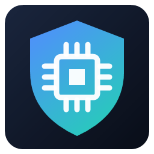
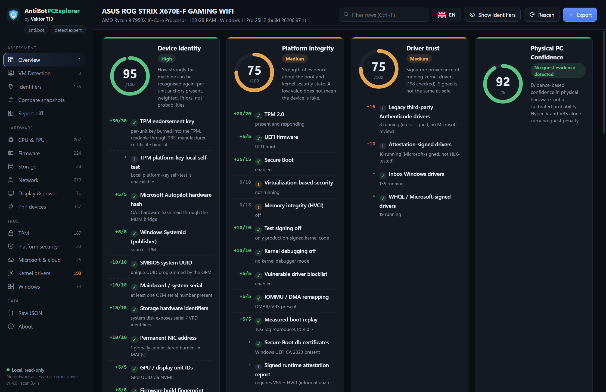
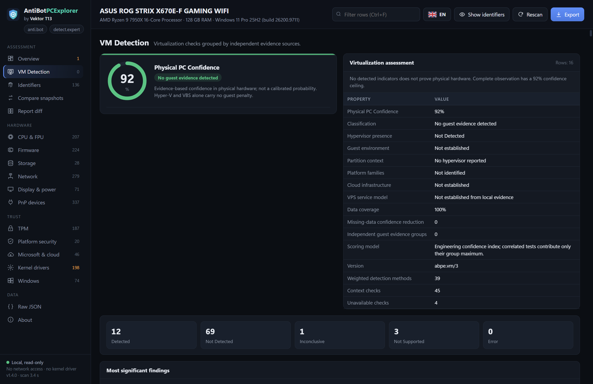
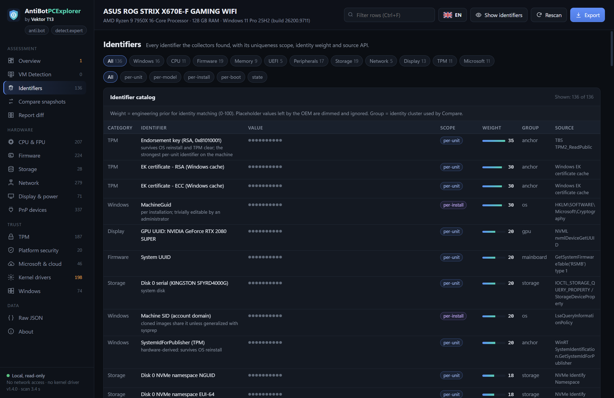

<p align="center">
  <a href="README.md">🇬🇧 English</a> · <a href="README.ru.md">🇷🇺 Русский</a> · <a href="README.vi.md">🇻🇳 Tiếng Việt</a> · <a href="README.zh-Hant.md">🇹🇼 繁體中文</a>
</p>

<p align="center">
  
</p>
<h1 align="center">AntiBotPCExplorer - VM Detection and Hardware Fingerprinting</h1>
<p align="center"><strong>Hiểu rõ phần cứng. Nắm rõ danh tính thiết bị.</strong><br>Kiểm tra dấu vân tay thiết bị, bảo mật nền tảng và môi trường ảo hóa trên Windows.<br>do <strong>Vektor T13</strong> phát triển</p>
<p align="center"><a href="https://detect.expert">detect.expert</a> · <a href="https://anti.bot">anti.bot</a> · <a href="https://antidetect.com">antidetect.com</a></p>

<p align="center">
  <a href="https://github.com/vektort13/AntiBotPCExplorer-VM-Detection-and-Hardware-Fingerprinting/releases/latest"></a>
  <a href="https://github.com/vektort13/AntiBotPCExplorer-VM-Detection-and-Hardware-Fingerprinting/releases"></a>
  
  <a href="LICENSE"></a>
  
</p>

<p align="center">
  <a href="https://github.com/vektort13/AntiBotPCExplorer-VM-Detection-and-Hardware-Fingerprinting/releases/latest/download/AntiBotPCExplorer-1.4.0-x64.exe"></a>
</p>
<p align="center">
  <a href="https://github.com/vektort13/AntiBotPCExplorer-VM-Detection-and-Hardware-Fingerprinting/releases/latest">Bản phát hành mới nhất</a> · <a href="docs/vi/installation.md">Cài đặt</a> · <a href="docs/vi/features.md">Tính năng</a> · <a href="docs/vi/faq.md">Câu hỏi thường gặp</a> · <a href="https://github.com/vektort13/AntiBotPCExplorer-VM-Detection-and-Hardware-Fingerprinting/issues">Hỗ trợ</a>
</p>

---

AntiBotPCExplorer tập hợp mã định danh phần cứng, thông tin firmware, dữ liệu TPM, danh tính Windows và bảo mật nền tảng trong một ứng dụng kiểm tra trên máy tính. Khám phá các tín hiệu dùng để nhận diện máy tính, xem xét dấu hiệu ảo hóa và so sánh báo cáo trước và sau khi thay đổi hệ thống.

**Một tệp thực thi chạy trực tiếp. Chẩn đoán ngay trên máy. Mã định danh được ẩn theo mặc định.** Ứng dụng được ký số bởi **Vektor T13 Technologies B.V.**

<p align="center">
  
</p>

## Bạn có thể làm gì

| Khả năng | Thông tin bạn nhận được |
|---|---|
|  **Khám phá danh tính thiết bị** | Hồ sơ CPU và FPU, firmware, thiết bị lưu trữ, bộ điều hợp mạng, màn hình, thiết bị PnP và mã định danh Windows tại cùng một nơi. |
|  **Kiểm tra độ tin cậy của nền tảng** | Thuộc tính TPM, Secure Boot, VBS/HVCI, dữ liệu khởi động và thông tin chữ ký trình điều khiển nhân hệ điều hành. |
|  **So sánh ảnh chụp trạng thái hệ thống** | So sánh theo nhóm danh tính, mô phỏng các tình huống thay đổi và xem khác biệt giữa báo cáo theo từng trường, có bộ lọc bỏ qua các trường thường xuyên thay đổi. |
|  **Giữ hoạt động chẩn đoán trên máy** | Thu thập ngoại tuyến, che mã định danh và xuất báo cáo JSON bảo vệ quyền riêng tư bằng thẻ HMAC. |

### Nhìn nhanh về môi trường ảo hóa

Phiên bản **1.4.0** bổ sung trang **VM Detection** riêng và điểm **Physical PC Confidence**. Xem dữ liệu được nhóm theo nguồn, trạng thái kiểm tra, mức đóng góp vào điểm số và chi tiết kỹ thuật từ CPU, firmware, thiết bị, đồ họa đến các thành phần tích hợp máy ảo khách.

Việc đánh giá tính đến dữ liệu có tương quan và những nguồn không khả dụng. Hyper-V hoặc VBS chạy trên máy Windows vật lý được xử lý riêng với dữ liệu cho thấy hệ thống là máy ảo khách.

<details>
<summary><strong>Xem VM Detection và danh mục mã định danh</strong></summary>

### VM Detection



### Mã định danh



</details>

## Bắt đầu trong một phút

1. [Tải AntiBotPCExplorer 1.4.0 cho Windows x64](https://github.com/vektort13/AntiBotPCExplorer-VM-Detection-and-Hardware-Fingerprinting/releases/latest/download/AntiBotPCExplorer-1.4.0-x64.exe).
2. Lưu tệp `.exe` vào thư mục bạn chọn rồi nhấp đúp để chạy. Không cần trình cài đặt.
3. Nếu cửa sổ thông báo thiếu môi trường chạy, hãy cài [Microsoft Edge WebView2 Runtime](https://developer.microsoft.com/en-us/microsoft-edge/webview2/) rồi khởi chạy lại ứng dụng.
4. Khám phá **Overview**, mở trang chi tiết hoặc xuất báo cáo. Chọn ngôn ngữ giao diện trong menu có biểu tượng lá cờ.

Dùng tài khoản Windows thông thường cho việc kiểm tra hằng ngày. **Run as administrator** cho phép đọc thêm thông tin firmware và hệ thống được bảo vệ.

| Yêu cầu | Cấu hình được hỗ trợ |
|---|---|
| Hệ điều hành | Windows 10 hoặc Windows 11 |
| Kiến trúc | x64 (Intel / AMD 64 bit) |
| Giao diện máy tính | Microsoft Edge WebView2 Runtime |
| Cài đặt | Tệp `.exe` chạy trực tiếp; không cần cài .NET |
| Kết nối Internet | Không cần khi chẩn đoán |

Xem [hướng dẫn cài đặt](docs/vi/installation.md) để biết cách cài môi trường chạy, xác minh SHA-256, cập nhật và sử dụng dòng lệnh.

## Báo cáo phù hợp với quy trình làm việc của bạn

Xuất báo cáo JSON bảo vệ quyền riêng tư mà không mở giao diện máy tính:

```powershell
Start-Process .\AntiBotPCExplorer-1.4.0-x64.exe -ArgumentList '--export','report.json' -Wait
```

Mở giao diện bằng một ngôn ngữ cụ thể:

```powershell
.\AntiBotPCExplorer-1.4.0-x64.exe --lang en
```

Giao diện máy tính có **Compare snapshots** và **Report diff**. Các báo cáo được tạo bằng cùng một khóa HMAC cục bộ có thể được so sánh trong khi mã định danh vẫn được che. [Tìm hiểu về báo cáo và dữ liệu cục bộ](docs/vi/privacy.md).

## Công nghệ sử dụng

<p>
  
  
  
  
  
  
</p>

Ứng dụng C++ gốc sử dụng các API Windows và giao diện HTML, CSS, JavaScript nhúng, được hiển thị bằng Microsoft Edge WebView2. Giao diện và các bản dịch đều nằm trong tệp thực thi.

## Ngôn ngữ

**Giao diện ứng dụng — 9 ngôn ngữ:** English, Русский, Tiếng Việt, 简体中文, 繁體中文, Español, Português (Brasil), Français và Deutsch.

**Tài liệu sản phẩm — 4 ngôn ngữ:** [English](README.md), [Русский](README.ru.md), [Tiếng Việt](README.vi.md) và [繁體中文](README.zh-Hant.md). Mỗi bản đều có hướng dẫn cài đặt, tính năng, câu hỏi thường gặp và tài liệu về quyền riêng tư.

## Tài liệu và hỗ trợ

| Nội dung | Liên kết |
|---|---|
| Cài đặt, chạy, cập nhật và xác minh tệp tải xuống | [Cài đặt](docs/vi/installation.md) |
| Khám phá công cụ kiểm tra và xử lý báo cáo | [Hướng dẫn tính năng](docs/vi/features.md) |
| Các câu hỏi thường gặp | [Câu hỏi thường gặp](docs/vi/faq.md) |
| Xuất báo cáo, che mã định danh và dữ liệu cục bộ | [Quyền riêng tư và báo cáo](docs/vi/privacy.md) |
| Lịch sử phiên bản | [Nhật ký thay đổi](CHANGELOG.vi.md) |
| Tệp tải xuống và ghi chú phát hành | [GitHub Releases](https://github.com/vektort13/AntiBotPCExplorer-VM-Detection-and-Hardware-Fingerprinting/releases) |
| Báo lỗi, câu hỏi và đề xuất tính năng | [GitHub Issues](https://github.com/vektort13/AntiBotPCExplorer-VM-Detection-and-Hardware-Fingerprinting/issues) · [Hướng dẫn phản hồi](CONTRIBUTING.vi.md) |
| Báo cáo bảo mật | [Chính sách bảo mật](SECURITY.vi.md) |
| Website sản phẩm | [detect.expert](https://detect.expert) · [anti.bot](https://anti.bot) · [antidetect.com](https://antidetect.com) |

## Phân phối

AntiBotPCExplorer là **sản phẩm độc quyền, mã nguồn đóng**. Kho lưu trữ này cung cấp tài liệu chính thức, hình ảnh sản phẩm và các bản phát hành nhị phân. Mã nguồn ứng dụng được giữ riêng tư. Xem [LICENSE](LICENSE) và [thông báo về thành phần bên thứ ba](THIRD_PARTY_NOTICES.md).
