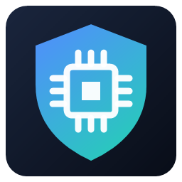
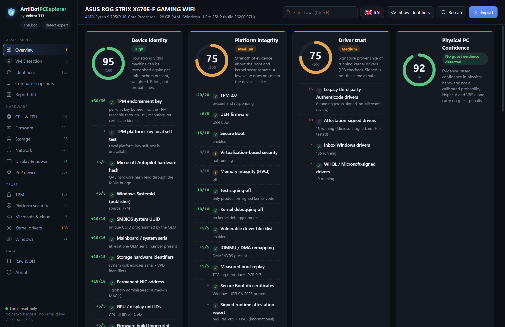
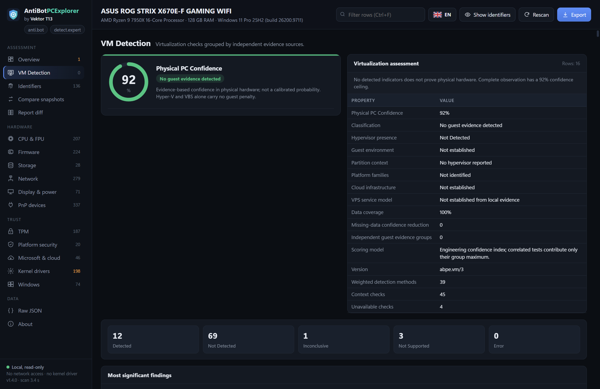
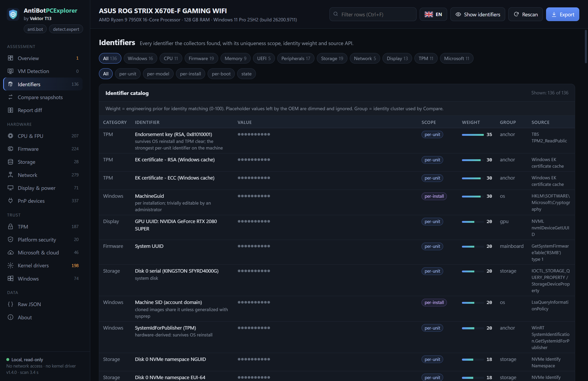

<p align="center">
  <a href="README.md">🇬🇧 English</a> · <a href="README.ru.md">🇷🇺 Русский</a> · <a href="README.vi.md">🇻🇳 Tiếng Việt</a> · <a href="README.zh-Hant.md">🇹🇼 繁體中文</a>
</p>

<p align="center">
  
</p>
<h1 align="center">AntiBotPCExplorer - VM Detection and Hardware Fingerprinting</h1>
<p align="center"><strong>掌握硬體資訊，了解裝置身分。</strong><br>專為 Windows 打造的裝置指紋、平台安全性與虛擬化診斷工具。<br>由 <strong>Vektor T13</strong> 開發</p>
<p align="center"><a href="https://detect.expert">detect.expert</a> · <a href="https://anti.bot">anti.bot</a> · <a href="https://antidetect.com">antidetect.com</a></p>

<p align="center">
  <a href="https://github.com/vektort13/AntiBotPCExplorer-VM-Detection-and-Hardware-Fingerprinting/releases/latest"></a>
  <a href="https://github.com/vektort13/AntiBotPCExplorer-VM-Detection-and-Hardware-Fingerprinting/releases"></a>
  
  <a href="LICENSE"></a>
  
</p>

<p align="center">
  <a href="https://github.com/vektort13/AntiBotPCExplorer-VM-Detection-and-Hardware-Fingerprinting/releases/latest/download/AntiBotPCExplorer-1.4.0-x64.exe"></a>
</p>
<p align="center">
  <a href="https://github.com/vektort13/AntiBotPCExplorer-VM-Detection-and-Hardware-Fingerprinting/releases/latest">最新版本</a> · <a href="docs/zh-Hant/installation.md">安裝指南</a> · <a href="docs/zh-Hant/features.md">功能介紹</a> · <a href="docs/zh-Hant/faq.md">常見問題</a> · <a href="https://github.com/vektort13/AntiBotPCExplorer-VM-Detection-and-Hardware-Fingerprinting/issues">技術支援</a>
</p>

---

AntiBotPCExplorer 將硬體識別碼、韌體資訊、TPM 證據、Windows 身分資訊與平台安全性整合到單一桌面檢視工具中。您可以探索用於識別電腦的各種訊號、檢查虛擬化證據，並比較系統變更前後的報告。

**單一可攜式執行檔。本機診斷。預設隱藏識別碼。** 應用程式由 **Vektor T13 Technologies B.V.** 進行數位簽章。

<p align="center">
  
</p>

## 您可以做什麼

| 功能 | 提供的資訊 |
|---|---|
|  **探索裝置身分** | 集中檢視 CPU 與 FPU 特徵、韌體、儲存裝置、網路介面卡、顯示器、PnP 裝置及 Windows 識別碼。 |
|  **檢查平台信任狀態** | TPM 屬性、安全開機、VBS/HVCI、開機證據及核心驅動程式簽章資訊。 |
|  **比較系統快照** | 比較身分資訊群組、模擬不同變更情境，並在排除易變動欄位後逐欄檢視報告差異。 |
|  **在本機完成診斷** | 離線收集資料、遮蔽識別碼，並匯出使用 HMAC 標記的隱私保護 JSON 報告。 |

### 一目了然的虛擬化診斷

**1.4.0** 版新增專屬的 **VM Detection（虛擬機器偵測）** 頁面與 **Physical PC Confidence（實體電腦可信度）** 分數。您可以檢視 CPU、韌體、裝置、圖形硬體及客體整合元件的分組證據、檢查狀態、分數貢獻與技術細節。

評估時會考量證據之間的關聯性及無法取得的資料。在實體 Windows 主機上執行的 Hyper-V 或 VBS，會與客體虛擬機器的證據分開處理。

<details>
<summary><strong>查看虛擬機器偵測與識別碼目錄</strong></summary>

### 虛擬機器偵測



### 識別碼



</details>

## 一分鐘開始使用

1. [下載適用於 Windows x64 的 AntiBotPCExplorer 1.4.0](https://github.com/vektort13/AntiBotPCExplorer-VM-Detection-and-Hardware-Fingerprinting/releases/latest/download/AntiBotPCExplorer-1.4.0-x64.exe)。
2. 將 `.exe` 儲存至您選擇的資料夾，然後按兩下執行。無須安裝。
3. 若視窗提示缺少執行階段，請安裝 [Microsoft Edge WebView2 Runtime](https://developer.microsoft.com/en-us/microsoft-edge/webview2/)，再重新啟動應用程式。
4. 瀏覽 **Overview（總覽）**、開啟詳細資訊頁面，或匯出報告。您可以在旗幟選單中選擇介面語言。

日常檢視可使用標準 Windows 帳戶。**以系統管理員身分執行**可取得更多受保護的韌體與系統資訊。

| 需求 | 支援的組態 |
|---|---|
| 作業系統 | Windows 10 或 Windows 11 |
| 架構 | x64（64 位元 Intel / AMD） |
| 桌面介面 | Microsoft Edge WebView2 Runtime |
| 安裝方式 | 可攜式 `.exe`；無須安裝 .NET |
| 網際網路連線 | 診斷時不需要 |

執行階段設定、SHA-256 驗證、更新與命令列用法，請參閱[安裝指南](docs/zh-Hant/installation.md)。

## 配合您工作流程的報告

無須開啟桌面介面，即可匯出隱私保護 JSON 報告：

```powershell
Start-Process .\AntiBotPCExplorer-1.4.0-x64.exe -ArgumentList '--export','report.json' -Wait
```

以指定語言開啟介面：

```powershell
.\AntiBotPCExplorer-1.4.0-x64.exe --lang en
```

桌面介面提供 **Compare snapshots（比較快照）** 與 **Report diff（報告差異）**。使用同一本機 HMAC 金鑰建立的報告，即使識別碼維持遮蔽，仍可進行比較。[了解報告與本機資料](docs/zh-Hant/privacy.md)。

## 使用的技術

<p>
  
  
  
  
  
  
</p>

以原生 C++ 開發，透過 Windows API 取得系統資訊，並使用 Microsoft Edge WebView2 呈現內嵌的 HTML、CSS 與 JavaScript 介面。介面與翻譯均包含在執行檔中。

## 語言

**應用程式介面 — 9 種語言：** English、Русский、Tiếng Việt、简体中文、繁體中文、Español、Português (Brasil)、Français 及 Deutsch。

**產品文件 — 4 種語言：** [English](README.md)、[Русский](README.ru.md)、[Tiếng Việt](README.vi.md) 及[繁體中文](README.zh-Hant.md)。每個語言版本均包含安裝指南、功能介紹、常見問題與隱私權文件。

## 文件與支援

| 資源 | 連結 |
|---|---|
| 安裝、執行、更新與驗證下載檔案 | [安裝指南](docs/zh-Hant/installation.md) |
| 了解檢視工具與報告功能 | [功能指南](docs/zh-Hant/features.md) |
| 常見問題 | [常見問題](docs/zh-Hant/faq.md) |
| 匯出、識別碼遮蔽與本機資料 | [隱私權與報告](docs/zh-Hant/privacy.md) |
| 版本歷程 | [更新紀錄](CHANGELOG.zh-Hant.md) |
| 下載與版本說明 | [GitHub Releases](https://github.com/vektort13/AntiBotPCExplorer-VM-Detection-and-Hardware-Fingerprinting/releases) |
| 錯誤、問題與功能建議 | [GitHub Issues](https://github.com/vektort13/AntiBotPCExplorer-VM-Detection-and-Hardware-Fingerprinting/issues) · [意見回饋指南](CONTRIBUTING.zh-Hant.md) |
| 安全性回報 | [安全性政策](SECURITY.zh-Hant.md) |
| 產品網站 | [detect.expert](https://detect.expert) · [anti.bot](https://anti.bot) · [antidetect.com](https://antidetect.com) |

## 發行方式

AntiBotPCExplorer 是**專有、封閉原始碼產品**。本儲存庫提供官方文件、產品圖片與二進位發行版本。應用程式原始碼保持私有。請參閱 [LICENSE](LICENSE) 與[第三方聲明](THIRD_PARTY_NOTICES.md)。
